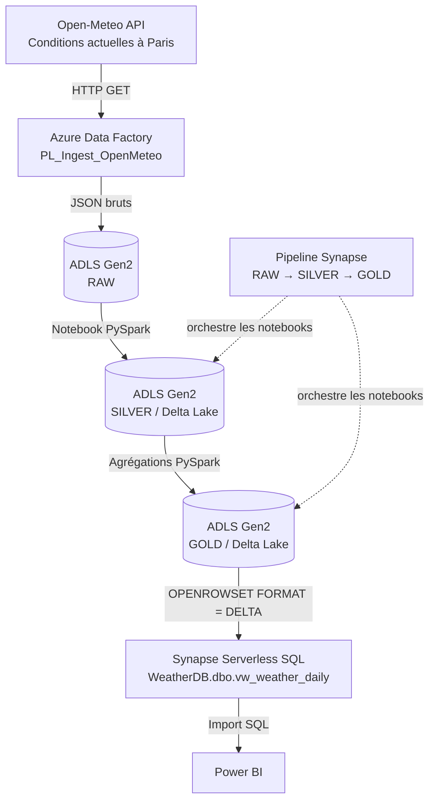

# 5CLOU — Paris Weather Analytics

**Pipeline de données météorologiques sur Microsoft Azure, de l'ingestion Open-Meteo à la visualisation Power BI.**

Projet académique de Data Engineering / Cloud réalisé à **SUPINFO Paris**. L'objectif est de mettre en œuvre une architecture *Medallion* (RAW → SILVER → GOLD), de contrôler la qualité des données et de rendre des indicateurs météorologiques quotidiens accessibles à des outils de Business Intelligence.

> **Statut :** pipeline d'ingestion et transformations Azure réalisés ; exposition SQL opérationnelle ; visualisations Power BI en cours de finalisation. Le jeu de données présenté ci-dessous correspond à une exécution de démonstration, et non à un suivi météorologique continu en temps réel.

## Architecture



**À noter :** le déclencheur d'ingestion ADF et le pipeline de transformation Synapse sont deux orchestrations distinctes. Aucun déclenchement automatique d'ADF vers Synapse n'est démontré dans les définitions du projet.

## Technologies

| Technologie | Utilisation |
| --- | --- |
| **Open-Meteo** | API publique de données météorologiques |
| **Azure Data Factory (ADF)** | Collecte HTTP et copie des réponses JSON vers RAW |
| **Azure Data Lake Storage Gen2** | Stockage des couches RAW, SILVER et GOLD |
| **Azure Synapse Analytics / Apache Spark** | Nettoyage, validation, déduplication, agrégations PySpark |
| **Delta Lake** | Tables SILVER et GOLD ; `MERGE` incrémental sur SILVER |
| **Synapse Serverless SQL** | Exposition des agrégations GOLD au moyen d'une vue SQL |
| **Power BI** | Modélisation et visualisations météorologiques (en cours) |
| **GitHub** | Versionnement natif des ressources ADF et Synapse |

## Source et ingestion des données

Le pipeline `PL_Ingest_OpenMeteo` exécute l'activité `Copy_OpenMeteo_To_Raw` : une requête HTTP `GET` récupère une réponse JSON de l'API Open-Meteo, puis ADF la copie **sans transformation** dans le Data Lake.

- **Ville :** Paris (`latitude=48.8566`, `longitude=2.3522`).
- **Endpoint :** `https://api.open-meteo.com/v1/forecast`
- **Champs demandés :** `temperature_2m`, `relative_humidity_2m`, `wind_speed_10m` dans `current`.
- **Authentification HTTP :** anonyme, avec validation du certificat serveur activée.
- **Destination :** `abfss://synapse@st5clouweather.dfs.core.windows.net/raw/`
- **Nommage :** `weather_paris_<horodatage_UTC>_<pipeline_RunId>.json`.
- **Résilience ADF :** délai maximal de 10 minutes par activité, 3 nouvelles tentatives, espacées de 30 secondes.

Le déclencheur `TR_OpenMeteo_15min` est configuré pour une fréquence de **15 minutes**. La fenêtre enregistrée dans Git s'étend du **12 novembre 2026 à 18 h 45 au 12 novembre 2026 à 20 h 30**, fuseau **W. Central Africa Standard Time (UTC+1)**. Cette fenêtre est terminée ; la présence de `runtimeState: Started` dans le JSON ne prouve pas que des ingestions continuent aujourd'hui.

> Les fichiers RAW conservent les réponses de l'API. Plusieurs appels peuvent renvoyer la même observation météo : une déduplication est effectuée en SILVER.

## Traitements PySpark : architecture Medallion

### RAW → SILVER

Le notebook [`NB_Weather_Raw_To_Silver`](synapse/notebook/NB_Weather_Raw_To_Silver.json), exécuté sur le pool `spark5clou`, réalise les opérations suivantes :

1. Lit les JSON du répertoire `raw/` via Spark (`multiLine=true`).
2. Extrait l'heure de mesure, les variables météo, les coordonnées et le fuseau horaire ; convertit les types.
3. Écarte les lignes sans horodatage ou température.
4. Déduplique sur **(`measurement_time`, `latitude`, `longitude`)**.
5. Contrôle les valeurs manquantes, les doublons et les plages de valeurs (humidité 0–100 %, température −50 à 60 °C, vent ≥ 0, coordonnées valides).
6. Crée la table Delta SILVER si elle n'existe pas, sinon effectue un **`MERGE` avec insertion des nouvelles clés uniquement**.
7. Relit la table et vérifie à nouveau les contraintes de qualité.

**Sortie :** `abfss://synapse@st5clouweather.dfs.core.windows.net/silver/weather_measurements/`.

Ce traitement est **incrémental à l'écriture**, mais relit les fichiers RAW disponibles lors de chaque exécution.

### SILVER → GOLD

Le notebook [`NB_Weather_Silver_To_Gold`](synapse/notebook/NB_Weather_Silver_To_Gold.json) regroupe les observations **par date** et calcule :

| Colonne GOLD | Signification |
| --- | --- |
| `date` | Jour de la mesure |
| `avg_temperature_c` | Température moyenne quotidienne (°C) |
| `min_temperature_c` / `max_temperature_c` | Températures extrêmes du jour (°C) |
| `avg_humidity_pct` | Humidité relative moyenne (%) |
| `avg_wind_speed_kmh` / `max_wind_speed_kmh` | Vent moyen et maximal (km/h) |
| `measurement_count` | Nombre d'observations agrégées |

**Sortie :** `abfss://synapse@st5clouweather.dfs.core.windows.net/gold/weather_daily/`.

La couche GOLD est **recalculée intégralement**, puis réécrite en Delta (`overwrite` et `overwriteSchema`). Les contrôles vérifient notamment l'unicité des dates, la cohérence des températures, la plage d'humidité et l'égalité entre le total d'observations GOLD et SILVER.

### Orchestration Synapse

Le pipeline [`PL_Transform_Weather_Silver_Gold`](synapse/pipeline/PL_Transform_Weather_Silver_Gold.json) exécute séquentiellement :

1. `Execute_Raw_To_Silver` → notebook `NB_Weather_Raw_To_Silver` ;
2. `Execute_Silver_To_Gold` → notebook `NB_Weather_Silver_To_Gold` **uniquement si le premier réussit**.

Les deux activités utilisent `spark5clou`, deux exécuteurs de taille *Small* et une authentification `MSI`. La politique d'exécution indique **12 heures de timeout par activité** et **aucun retry automatique**.

## Tests et qualité des données

Les notebooks principaux intègrent des contrôles `assert` : le traitement échoue si les données ne respectent pas les contraintes définies.

Le notebook [`NB_Weather_Raw_To_Silver_Tests`](synapse/notebook/NB_Weather_Raw_To_Silver_Tests.json) sert à **expérimenter les chargements Delta et le `MERGE`**, dont l'insertion puis la suppression d'une observation fictive. **Attention : il contient un `mode("overwrite")` sur SILVER ; ne pas le relancer tel quel sur les données de production.** Il s'agit d'un notebook de tests d'intégration manuels, pas d'une suite complète de tests unitaires automatisés.

## Exposition SQL et Power BI

La base **`WeatherDB`**, sur le moteur **Synapse Serverless SQL** (`syn-5clou-weather-ondemand.sql.azuresynapse.net`), contient la vue **`dbo.vw_weather_daily`**. Celle-ci lit directement la table GOLD au format Delta avec `OPENROWSET`.

Le script de définition est disponible dans [`sql/create_weather_view.sql`](sql/create_weather_view.sql).

Power BI Desktop se connecte à `WeatherDB` avec le connecteur SQL Server, en mode **Import**. Les indicateurs globaux calculés à partir de moyennes quotidiennes doivent être **pondérés par `measurement_count`** pour ne pas attribuer le même poids à une journée avec une seule mesure et à une journée avec plusieurs mesures.

> Le dashboard Power BI et ses captures d'écran seront ajoutés après finalisation. Les permissions SQL, de stockage et les règles réseau Azure doivent être correctement configurées pour actualiser les données depuis une autre session.

## Résultats de démonstration

Les sorties sauvegardées des notebooks montrent **six observations uniques**, agrégées sur **deux journées** :

| Date | Température moy. | Temp. min. | Temp. max. | Humidité moy. | Vent moyen | Vent max. | Mesures |
| --- | ---: | ---: | ---: | ---: | ---: | ---: | ---: |
| 2026-11-11 | 14,10 °C | 14,10 °C | 14,10 °C | 84,0 % | 3,30 km/h | 3,30 km/h | 1 |
| 2026-11-12 | 9,04 °C | 8,60 °C | 9,90 °C | 71,4 % | 15,38 km/h | 15,90 km/h | 5 |

La température moyenne de l'ensemble des **six observations**, reconstituée à partir des moyennes quotidiennes pondérées, est d'environ **9,88 °C**. Ces chiffres sont un instantané du jeu de démonstration, et **ne décrivent pas la météo actuelle**.

## Structure du dépôt

```text
.
├── adf/                  # Pipelines, datasets, services liés et déclencheurs ADF
├── synapse/              # Notebooks, pipeline Synapse et configurations
├── sql/
│   └── create_weather_view.sql
└── README.md
```

Le dépôt contient les définitions versionnées des ressources ; **il ne contient pas les données RAW/SILVER/GOLD**, stockées dans Azure, ni l'infrastructure complète nécessaire pour les exécuter immédiatement.

## Reproduire le projet

1. Disposer d'un abonnement Azure autorisé à créer Azure Data Factory, Synapse Analytics, Spark et ADLS Gen2.
2. Créer/configurer un compte ADLS Gen2 et un conteneur avec des dossiers `raw/`, `silver/`, `gold/` ; adapter les noms de compte et de conteneur codés dans les notebooks.
3. Configurer les services liés ADF, les autorisations d'accès au Data Lake et les ressources Synapse ; ajuster les paramètres du pool Spark et les règles réseau.
4. Déployer les définitions ADF et Synapse depuis leurs dossiers respectifs, avec des paramètres propres à l'environnement. **Les fichiers JSON seuls ne constituent pas un déploiement automatique.**
5. Exécuter l'ingestion Open-Meteo, puis le pipeline de transformation Synapse. Contrôler les sorties et les assertions de qualité.
6. Créer `WeatherDB` sur le moteur SQL Serverless et, **sur une base de données vierge**, exécuter le script de création de la vue. Ne pas relancer un `CREATE VIEW` sur la vue existante.
7. Connecter Power BI à l'endpoint SQL Serverless et construire/actualiser les visualisations.

**Sécurité :** ne jamais publier de clés de stockage, secrets, mots de passe ou jetons. Les URL et identifiants de ressources présents dans les exemples ne suffisent pas à accorder un accès. Vérifier également l'historique Git avant de rendre le dépôt public.

## Limites et pistes d'amélioration

- **Volume restreint :** la démonstration porte sur deux journées et six observations ; elle ne permet pas de conclusions météorologiques générales.
- **Planification bornée :** le déclencheur ADF importé a une date de fin ; ce n'est pas un pipeline temps réel permanent.
- **Orchestration séparée :** l'ingestion ADF ne déclenche pas automatiquement la transformation Synapse dans les définitions analysées.
- **RAW relu entièrement :** l'ingestion des données dans SILVER pourrait être optimisée avec un suivi incrémental des nouveaux fichiers.
- **GOLD réécrite :** les agrégations quotidiennes sont recalculées intégralement à chaque exécution.
- **Tests d'intégration :** isoler le notebook de tests dans un stockage de test et compléter par des tests automatisés non destructifs.
- **Évolutivité :** enrichir l'historique, ajouter une supervision des exécutions, des alertes et une stratégie de déploiement automatisée.

## Équipe

Projet réalisé à **SUPINFO Paris**, avec une répartition des responsabilités entre **Rayelen Guesmi** et **Tharshan Sivapalan**.

---

*Projet académique — novembre 2026. Les services Azure et leurs tarifs, permissions et disponibilités dépendent de l'abonnement utilisé.*
