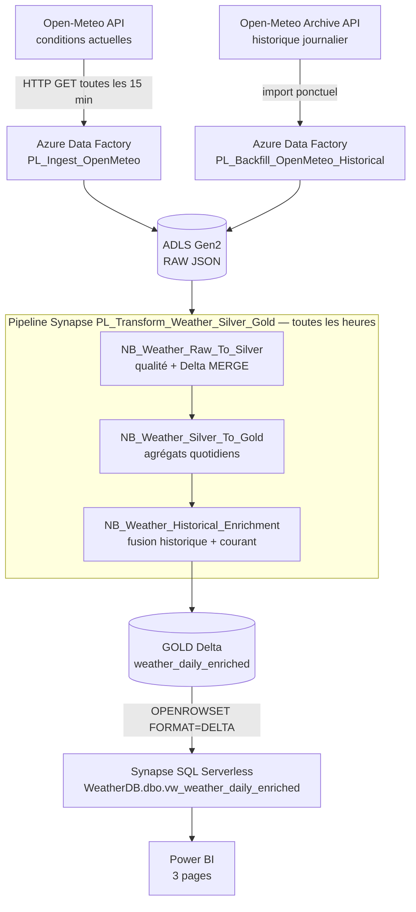

# 5CLOU — Paris Weather Analytics

**Plateforme de données météo temps réel sur Microsoft Azure : de l'API Open-Meteo au tableau de bord Power BI, entièrement automatisée.**

Projet académique de Data Engineering réalisé à **SUPINFO Paris** (MSc Ingénierie Data, 2026–2027) par **Rayelen Guesmi** et **Tharshan Sivapalan**.

La plateforme collecte les conditions météo de Paris toutes les 15 minutes, les transforme selon une architecture **Medallion** (RAW → SILVER → GOLD) avec Delta Lake, les fusionne avec un an d'historique et les expose dans un tableau de bord Power BI.

## Architecture



| Étape | Service | Planification |
|---|---|---|
| Ingestion | Azure Data Factory — `TR_OpenMeteo_15min` | toutes les 15 min |
| Transformation | Synapse Spark (PySpark, Delta Lake) — `TR_Transform_Hourly` | toutes les heures |
| Exposition | Synapse SQL Serverless — vue `vw_weather_daily_enriched` | lecture directe du GOLD |
| Visualisation | Power BI Desktop (DirectQuery) | actualisation automatique toutes les minutes |

## Technologies

| Technologie | Rôle |
|---|---|
| **Open-Meteo** | API publique : conditions actuelles (`/v1/forecast`) et historique (`/v1/archive`) |
| **Azure Data Factory** | Copie HTTP → Data Lake, déclencheur planifié, retries |
| **ADLS Gen2** | Stockage des couches RAW, SILVER, GOLD |
| **Azure Synapse / Apache Spark 3.5** | Notebooks PySpark, orchestration, contrôles qualité |
| **Delta Lake** | Tables SILVER/GOLD, `MERGE` incrémental |
| **Synapse SQL Serverless** | Vue SQL sur le GOLD pour la BI |
| **Power BI** | Tableau de bord interactif |
| **GitHub** | Versionnement natif ADF et Synapse |

Région Azure : **Germany West Central**. Authentification ADF → Data Lake par **identité managée** (aucune clé stockée).

## Ingestion (Azure Data Factory)

- **Pipeline** `PL_Ingest_OpenMeteo` — activité `Copy_OpenMeteo_To_Raw` : `GET https://api.open-meteo.com/v1/forecast?latitude=48.8566&longitude=2.3522&current=temperature_2m,relative_humidity_2m,wind_speed_10m`
- **Destination** : `raw/weather_paris_<UTC>_<RunId>.json` (nom unique par exécution, aucun écrasement)
- **Résilience** : timeout 10 min, 3 retries espacés de 30 s
- **Déclencheur** `TR_OpenMeteo_15min` : toutes les 15 min, fuseau Paris
- **Backfill** `PL_Backfill_OpenMeteo_Historical` : 375 journées (01/11/2025 → 10/11/2026) depuis l'API Archive vers `raw/historical_openmeteo/`

## Transformations (Synapse Spark)

Pipeline `PL_Transform_Weather_Silver_Gold`, 3 activités chaînées sur succès (retry 1, timeout 1 h), déclenché toutes les heures par `TR_Transform_Hourly` :

1. **`NB_Weather_Raw_To_Silver`** — extraction du JSON imbriqué, typage, déduplication sur (`measurement_time`, `latitude`, `longitude`), contrôles (nulls, doublons, plages de valeurs) avec `assert`, puis **Delta `MERGE`** (insertion des nouvelles mesures uniquement) → `silver/weather_measurements/`
2. **`NB_Weather_Silver_To_Gold`** — agrégats quotidiens (températures moy/min/max, humidité, vent moyen/max, nombre de mesures) et contrôles (`Tmin ≤ Tmoy ≤ Tmax`, cohérence SILVER/GOLD) → `gold/weather_daily/`
3. **`NB_Weather_Historical_Enrichment`** — historique RAW → SILVER, fusion avec le GOLD courant (l'archive couvre jusqu'au 10/11/2026, la collecte ADF ensuite), colonne `data_source` pour la provenance, contrôles qualité → `gold/weather_daily_enriched/`

`NB_Weather_Raw_To_Silver_Tests` : tests d'intégration manuels du `MERGE` (insertion puis suppression d'une mesure fictive), isolés dans `tests/silver_weather_measurements/`.

## Exposition SQL et Power BI

```sql
SELECT * FROM WeatherDB.dbo.vw_weather_daily_enriched ORDER BY date DESC;
```

Le rapport [`powerbi/Paris_Weather_Analytics.pbix`](powerbi/) se connecte à `syn-5clou-weather-ondemand.sql.azuresynapse.net` / `WeatherDB` :

- **Page 1 — Températures** : évolution mensuelle, courbes min/moy/max, indicateurs
- **Page 2 — Humidité & vent** : moyennes mensuelles, vent maximal
- **Page 3 — Détail** : tableau journalier, nombre de jours par mois, **date de la dernière donnée collectée**

Mesures principales : `Temperature_Moyenne` (moyenne simple des journées, l'historique n'ayant pas de nombre de mesures), `Amplitude_Thermique_Max`, `Jours_De_Chaleur` (Tmax ≥ 25 °C), `Derniere_Donnee`.

## Structure du dépôt

```text
.
├── adf/          # Pipelines, datasets, services liés, déclencheur ADF
├── docs/         # Rapport technique (PDF)
├── synapse/      # Notebooks, pipeline, déclencheur, script SQL de contrôle
├── sql/          # Définitions des vues SQL Serverless
├── powerbi/      # Rapport Power BI (.pbix)
└── README.md
```

Branches : `main` (collaboration), `adf_publish` et `workspace_publish` (modèles ARM publiés).

## Reproduire le projet

1. Créer un compte ADLS Gen2 (conteneur `synapse`), une Data Factory et un workspace Synapse avec un pool Spark.
2. Relier ADF (dossier `/adf`) et Synapse (dossier `/synapse`) à ce dépôt, puis **Publier**.
3. Donner à l'identité managée d'ADF et de Synapse le rôle *Storage Blob Data Contributor* sur le compte de stockage.
4. Exécuter une fois `PL_Backfill_OpenMeteo_Historical`, activer les deux déclencheurs.
5. Dans SQL Serverless, créer la base `WeatherDB` et exécuter les scripts de `sql/`.
6. Ouvrir le `.pbix`, adapter le serveur SQL si nécessaire et actualiser.

## Limites et perspectives

- Données historiques (agrégats journaliers) et données récentes (mesures au quart d'heure) de natures différentes, distinguées par `data_source`.
- Pas de données du 13 au 17/11/2026 (collecte interrompue).
- Latence horaire liée à la planification Synapse ; Power BI (DirectQuery) l'affiche dans la minute qui suit.
- Perspectives : actualisation planifiée dans Power BI Service, déclenchement Synapse sur événement de stockage, Terraform, tests en CI, migration vers Microsoft Fabric.
